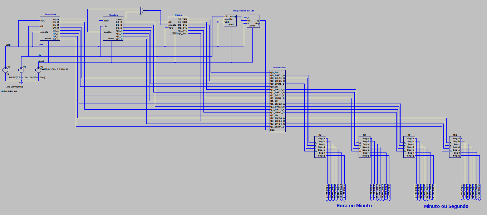
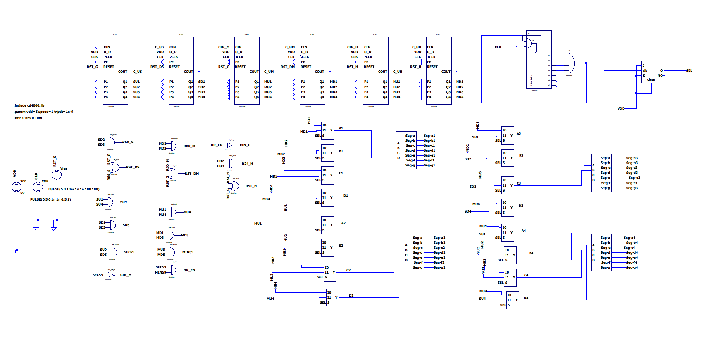
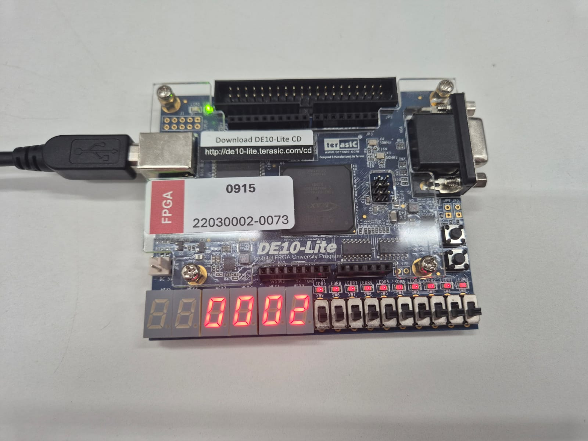
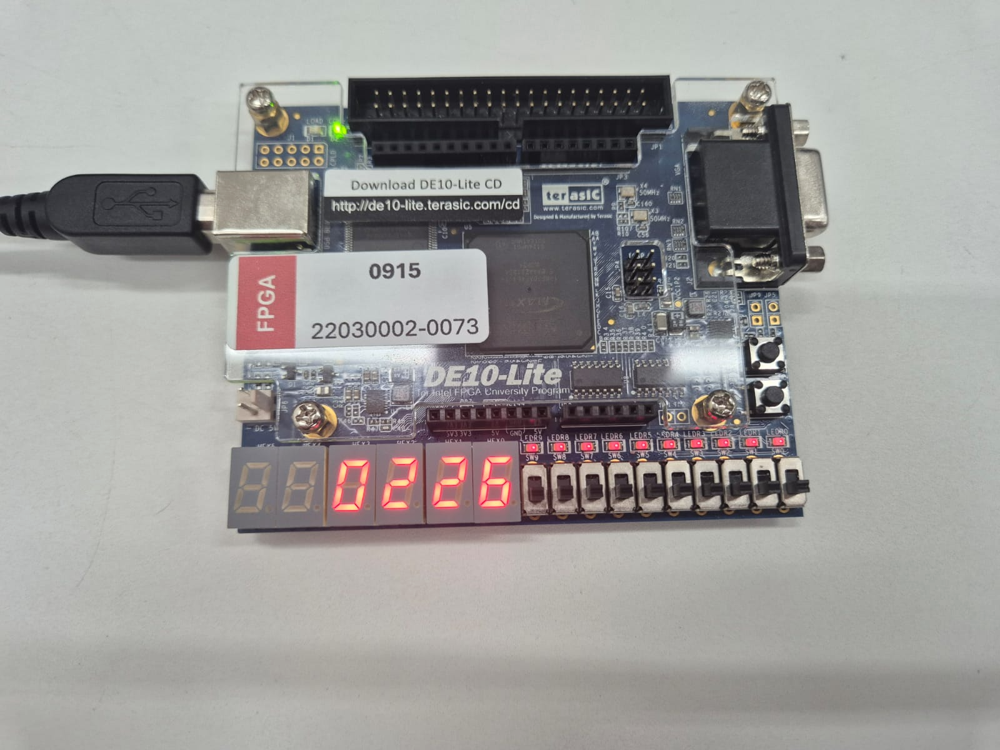

# relogio-digital-sincrono


Relógio digital síncrono de 24 horas, feito de três jeitos diferentes. O mesmo circuito é construído com portas lógicas CMOS, depois com contadores comerciais CMOS (os dois no LTspice) e por fim descrito em Verilog e gravado numa FPGA DE10-Lite.

O relógio tem quatro displays de 7 segmentos, então mostra só dois pares de dígitos por vez. A cada 15 segundos a exibição troca sozinha entre hora e minuto e minuto e segundo.

```
HH MM  (15 s)  ->  MM SS  (15 s)  ->  HH MM  (15 s)  ->  ...
```

## Recursos

- Contagem de 24 horas em BCD, com segundos e minutos em módulo 60 e horas em módulo 24
- Troca automática da exibição a cada 15 segundos
- Três implementações do mesmo relógio, da lógica discreta ao HDL
- Divisor de frequência que leva o clock de 50 MHz da placa até 1 Hz
- Multiplexação dos dados BCD e decodificação para 7 segmentos
- Testbench que simula as 24 horas completas com o tempo acelerado e confere as viradas de dia
- Reset geral por botão

## As três implementações

| Pasta | Abordagem | Ferramenta |
|-------|-----------|------------|
| `q1-portas-logicas/` | Tudo construído com portas lógicas CMOS 4000, a partir do flip-flop JK | LTspice |
| `q2-contadores-comerciais/` | Contadores CMOS comerciais (MSI) com lógica de interligação | LTspice |
| `q3-verilog-fpga/` | Transcrição da Q2 para Verilog, simulada e gravada na FPGA | ModelSim e Quartus |

## Como funciona

O fluxo é o mesmo nas três versões. O que muda é o nível em que cada bloco é construído.

```
 clock de 1 Hz
      |
      v
 contadores BCD          segundos (mod 60), minutos (mod 60), horas (mod 24)
      |
      |   contador mod 15 + flip-flop JK  ->  SEL (inverte a cada 15 s)
      |                                         |
      v                                         v
 multiplexadores 2 para 1  <--------------------+
      |
      v
 decodificadores BCD para 7 segmentos
      |
      v
 4 displays
```

Os multiplexadores escolhem o que cada display recebe conforme o sinal `SEL`.

| `SEL` | Display 1 | Display 2 | Display 3 | Display 4 | Exibição |
|-------|-----------|-----------|-----------|-----------|----------|
| 0 | dezena da hora | unidade da hora | dezena do minuto | unidade do minuto | hora e minuto |
| 1 | dezena do minuto | unidade do minuto | dezena do segundo | unidade do segundo | minuto e segundo |

O `SEL` vem de um contador de 15 estados. Quando ele chega em 14, habilita um flip-flop JK em modo toggle, que inverte o `SEL` no pulso seguinte, e ao chegar em 15 o contador volta a zero. Resultado, uma troca a cada 15 segundos.

### Q1 Portas lógicas

Abordagem de baixo para cima, usando só portas da família CMOS 4000.

- Flip-flop JK montado com portas NAND, AND, OR e NOT, que é a base de todos os contadores
- Contador módulo 60 (segundos e minutos), feito com um módulo 10 em cascata com um módulo 6
- Contador módulo 24 (horas), que trunca a contagem ao passar de 23
- Contador módulo 15, que gera o pulso de troca da exibição
- Multiplexador de 4 bits e decodificador BCD para 7 segmentos feitos com portas

Para simular, abra `Relogio_Digital_Questao1.asc` no LTspice. Os subcircuitos ficam na mesma pasta, e o projeto usa a biblioteca CD4000 que acompanha o LTspice.



### Q2 Contadores comerciais

Evolução da Q1. Os contadores discretos dão lugar a CIs comerciais da família CMOS, e o trabalho de projeto passa a ser a lógica de interligação, ou seja, as portas externas que ligam os CIs, definem os módulos de contagem e mantêm o sincronismo.

| Componente | Uso |
|------------|-----|
| CD4510B (6 unidades) | Contadores BCD de unidade e dezena de segundos, minutos e horas |
| CD4024B | Contador binário que alimenta o temporizador de 15 segundos |
| CD4081B, CD4082B | Portas AND para detectar valores e controlar reset |
| CD4071B | Porta OR |
| CD4049B | Inversores |

Abra `relogio_completo.asc` no LTspice. A análise transiente já está configurada para 65 segundos, o suficiente para ver a virada de minuto.



### Q3 Verilog e FPGA

A arquitetura da Q2 é transcrita para Verilog de forma hierárquica, com um módulo por arquivo e um módulo de topo que junta tudo. Os módulos `CD4510B` e `CD4024B` modelam o comportamento dos CIs reais, e um divisor de frequência adapta o clock de 50 MHz da placa para a base de 1 Hz do relógio.

| Arquivo | Função |
|---------|--------|
| `relogio.v` | Módulo de topo, liga contadores, multiplexadores e decodificadores |
| `CD4510B.v` | Contador BCD crescente e decrescente, com reset e carga paralela |
| `CD4024B.v` | Contador binário de 7 bits |
| `ffjk.v` | Flip-flop JK com reset assíncrono |
| `mux2_1.v` | Multiplexador 2 para 1 com largura parametrizável |
| `decodificador_7seg.v` | BCD para 7 segmentos |
| `divisor_frequencia.v` | Divide 50 MHz para 1 Hz |
| `tb_relogio.v` | Testbench |

#### Na placa

Requer Quartus Prime 18.1 Lite (ou superior) e uma placa DE10-Lite.

1. Abra `q3-verilog-fpga/relogio.qpf` no Quartus.
2. Compile em `Processing > Start Compilation`. Os pinos e a entidade de topo já estão configurados.
3. Programe a placa com o arquivo `.sof` gerado, em `Tools > Programmer`.
4. Use `KEY[0]` para zerar o relógio.

Os quatro displays usados são `HEX3`, `HEX2`, `HEX1` e `HEX0`, da esquerda para a direita.

#### Em simulação

O testbench reduz a contagem do divisor para que cada pulso de clock interno valha um segundo de relógio. Assim as 24 horas inteiras são simuladas em poucos milissegundos de tempo simulado.

1. No ModelSim, compile todos os arquivos `.v` da pasta.
2. Simule o módulo `tb_relogio`.
3. Execute com `run -all`.

O console mostra a hora a cada mudança de minuto e avisa quando acontece a virada de 23h59min59s para 00h00min00s.

#### Resultado na placa

| Hora e minuto | Minuto e segundo |
|:---:|:---:|
|  |  |
| Exibindo 00 e 02 | Exibindo 02 e 26 |

## Estrutura do projeto

```
relogio-digital-sincrono/
├── q1-portas-logicas/          # esquemáticos LTspice com portas CMOS
├── q2-contadores-comerciais/   # esquemático LTspice com CIs CMOS
├── q3-verilog-fpga/            # Verilog, testbench e projeto Quartus
├── imagens/
├── .gitignore
├── .gitattributes
├── LICENSE
└── README.md
```

## Decisões de projeto

**Por que três implementações?** Cada uma sobe um nível de abstração. Na Q1 aparece como funciona um contador por dentro, na Q2 o foco passa para a interligação entre blocos, e na Q3 o mesmo desenho vira texto que se simula e se grava em hardware.

**Por que o divisor usa 24.999.999?** O contador conta de 0 a 24.999.999, que são 25 milhões de ciclos de 20 ns, e inverte a saída a cada volta. Dois meios ciclos de 0,5 s dão um período de 1 s, ou seja, 1 Hz com 50% de duty cycle.

**Por que o reset da dezena testa só dois bits?** A dezena de segundos e a de minutos só chegam até 5, então ao aparecer 6 (0110) os bits 1 e 2 ficam em nível alto ao mesmo tempo, e nenhum valor anterior faz isso. Para as horas vale a mesma ideia com o valor 24.

**Por que o minuto só avança no segundo 59?** O contador de minutos fica desabilitado até os segundos chegarem a 59, e o de horas espera também o minuto chegar a 59. É isso que mantém o relógio síncrono, com todos os contadores no mesmo clock.

## Informações acadêmicas

Projeto da disciplina Eletrônica Digital II e Laboratório de Eletrônica Digital (2026).

| | |
|---|---|
| **Instituição** | Universidade Federal do Amazonas (UFAM) |
| **Faculdade** | Faculdade de Engenharia Elétrica e de Computação (FEEC) |
| **Departamento** | Eletrônica e Computação (DTEC) |
| **Professor** | Prof. Dr. Thiago Brito |

**Equipe**

- João Pedro Felipe Dantas
- Larissa Rafaela Ribeiro de Souza
- Paulo Lucas Tarola Moreira

## Licença

Distribuído sob a licença MIT. Veja o arquivo [LICENSE](LICENSE).
